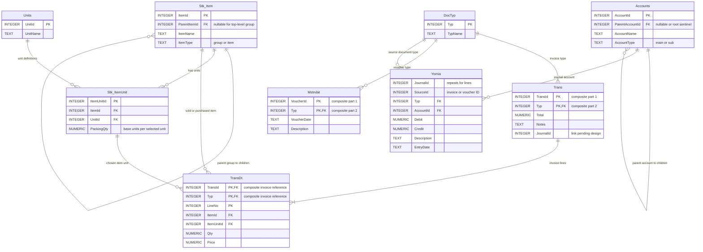
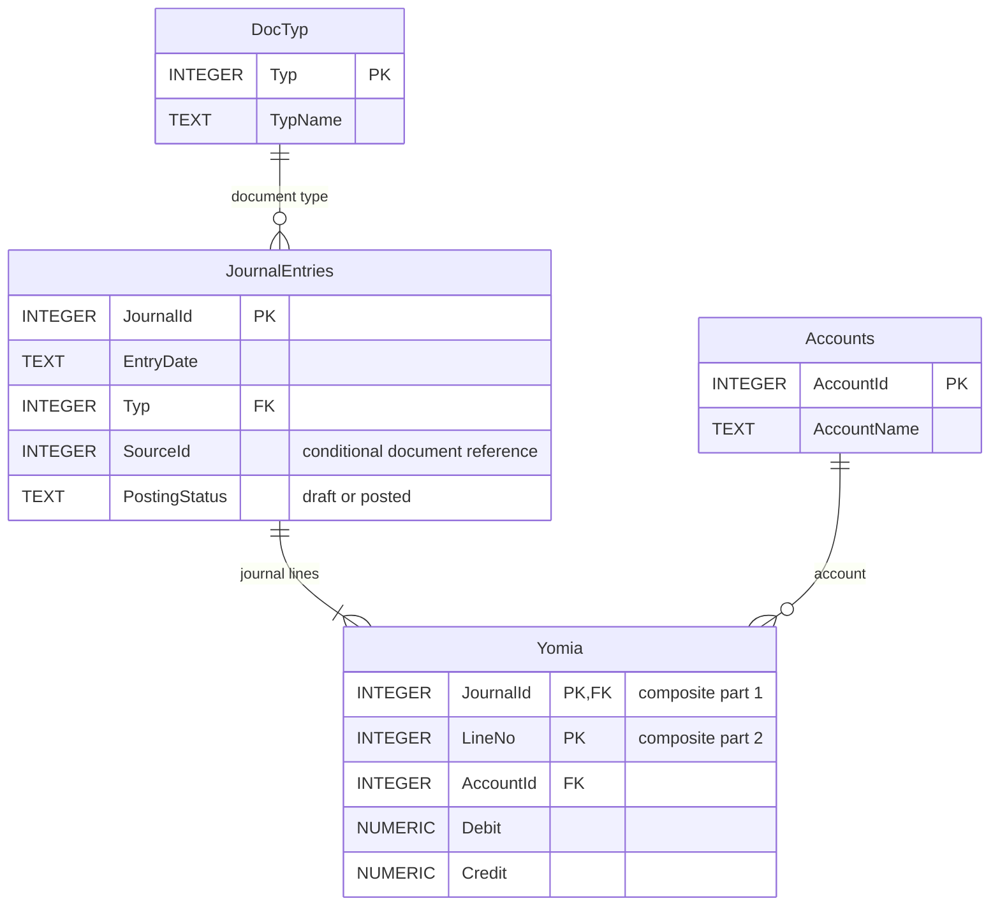
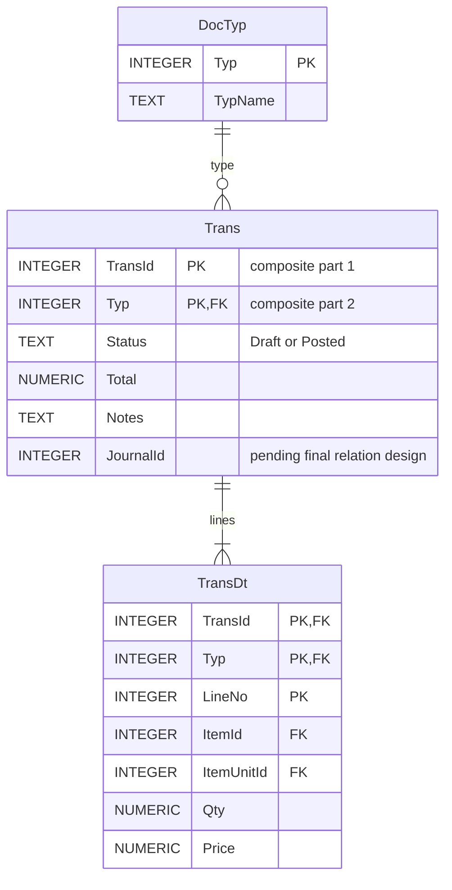

# المخطط الشامل للعلاقات — Accounting System ERD

يجمع هذا الملف متطلبات النظام السبعة في مخطط واحد، ويبيّن العلاقات بين الجداول. **هذا مخطط تحليل مبدئي وليس مخطط SQLite النهائي**؛ فبعض العلاقات تتطلب قرارات قبل التنفيذ.

## مخطط ERD الشامل

## كيف ترتبط الجداول؟

| من | إلى | العلاقة | المفتاح الأجنبي |
|---|---|---|---|
| Stk_Item (مجموعة) | Stk_Item (صنف/مجموعة فرعية) | 1:N ذاتية | Stk_Item.ParentItemId → Stk_Item.ItemId |
| Stk_Item | Stk_ItemUnit | 1:N | Stk_ItemUnit.ItemId → Stk_Item.ItemId |
| Units | Stk_ItemUnit | 1:N | Stk_ItemUnit.UnitId → Units.UnitId |
| Accounts (رئيسي) | Accounts (فرعي) | 1:N ذاتية | Accounts.ParentAccountId → Accounts.AccountId |
| DocTyp | Trans | 1:N | Trans.Typ → DocTyp.Typ |
| Trans | TransDt | 1:N | (TransDt.TransId, TransDt.Typ) → (Trans.TransId, Trans.Typ) |
| Stk_Item | TransDt | 1:N | TransDt.ItemId → Stk_Item.ItemId |
| Stk_ItemUnit | TransDt | 1:N | TransDt.ItemUnitId → Stk_ItemUnit.ItemUnitId |
| DocTyp | Mstndat | 1:N | Mstndat.Typ → DocTyp.Typ |
| DocTyp | Yomia | 1:N | Yomia.Typ → DocTyp.Typ |
| Accounts | Yomia | 1:N | Yomia.AccountId → Accounts.AccountId |

### علاقات تحتاج معالجة خاصة

**1. مصدر اليومية:** `Yomia.SourceId` قد يشير إلى `Trans.TransId` عندما يكون المصدر فاتورة، أو `Mstndat.VoucherId` عندما يكون المصدر سندًا. لذلك **لا يصح وضع مفتاح أجنبي مباشر واحد من SourceId إلى الجدولين**. نحتاج آلية تصميم/تحقق تضمن وجود المستند الصحيح مع `Typ`، أو فصل رأس القيد عن الأسطر وربطه بالمصدر بصورة صريحة.

**2. رابط `Trans.JournalId`:** لا يُرسم كمفتاح أجنبي مؤكد قبل تحديد مفتاح القيد المحاسبي وهيكل اليومية.

**3. وحدة الصنف:** يجب ضمان أن `TransDt.ItemUnitId` يخص `TransDt.ItemId` نفسه. مفتاحان أجنبيان منفصلان لا يضمنان ذلك وحدهما؛ يمكن تطبيق قيد مركب مناسب أو تحقق برمجي/قاعدة البيانات.

**4. مفتاح اليومية:** `JournalId` يتكرر في أسطر القيد، لذلك يلزم `LineNo` أو `JournalLineId` أو جدول رأس قيد مستقل. لم نعتمد الخيار النهائي بعد.

**5. الحسابات والأصناف الجذرية:** يلزم الاتفاق على تمثيل المجموعة العليا: `NULL` أو قيمة جذر خاصة، وفق قيود SQLite.

**6. ترقيم الفواتير والسندات:** المفاتيح المركبة `(TransId, Typ)` و`(VoucherId, Typ)` مقترحة للسماح بترقيم مستقل لكل نوع.

**7. تفاصيل إضافية:** مبالغ السندات، ترحيل القيود المتوازنة، والتحقق من أنواع المستندات وتخزين القيم المالية بدقة، كلها ستُحسم قبل SQL النهائي.

## تسلسل القراءة

- الأصناف ← وحدات الأصناف ← تفاصيل الفواتير ← رأس الفاتورة ← نوع المستند.
- شجرة الحسابات ← أسطر اليومية ← نوع المستند.
- نوع المستند ← السندات.
- ربط مصدر اليومية بالفاتورة/السند **مؤجل لحين اعتماد طريقة صحيحة**.

## ملفات التحليل التفصيلية

- [01 الأصناف والوحدات](01-items-units-erd.md)
- [02 الحسابات](02-accounts-erd.md)
- [03 أنواع المستندات](03-document-types-erd.md)
- [04 رأس الفاتورة](04-invoice-header-trans-erd.md)
- [05 تفاصيل الفاتورة](05-invoice-details-transdt-erd.md)
- [06 السندات](06-vouchers-mstndat-erd.md)
- [07 القيود اليومية](07-journal-yomia-erd.md)

## تحديث معتمد — فصل رأس القيد عن أسطر اليومية

**قرار التصميم:** نضيف جدول `JournalEntries` لرأس القيد، ونخصص `Yomia` لأسطره. هذا القسم هو الأحدث ويحل محل تصوير `Yomia` القديم في الرسم المبدئي أعلاه، إلى حين إعادة رسم النسخة الموحدة النهائية.

- `JournalEntries.JournalId` مفتاح أساسي؛ `Yomia (JournalId, LineNo)` مفتاح أساسي مركب.
- `JournalEntries.Typ → DocTyp.Typ`، و`Yomia.JournalId → JournalEntries.JournalId`، و`Yomia.AccountId → Accounts.AccountId`.
- `SourceId + Typ` يحدد مصدر القيد (فاتورة من `Trans` أو سند من `Mstndat`)، لكنه **ليس مفتاحًا أجنبيًا مباشرًا**. يلزم تحقق ملائم حسب نوع المستند، مع معالجة خاصة للقيد اليدوي `Typ=7`.
- **قاعدة عمل معتمدة:** عند ترحيل فاتورة محاسبيًا تُمنع التعديلات والحذف المباشر عليها؛ ويكون التصحيح عبر مرتجع أو إجراء عكسي مضبوط مع سجل تدقيق، وليس تغيير البيانات المرحّلة بصمت.
- لا يرحّل أي قيد قبل التحقق من تساوي مجموع المدين والدائن، ومن وجود أسطر صالحة. يمكن الاحتفاظ بالقيود غير المكتملة كمسودات.
- يجب تطبيق الترحيل وتغيير حالة المستند والقيود في معاملة واحدة، مع ضمان سلامة العلاقات.
- لا نستخدم حذفًا متسلسلًا `ON DELETE CASCADE` لمسح قيود مالية مرحّلة.
- **قيد التنفيذ:** هذا التحديث يعتمد سياسة العمل وهيكل اليومية، لكن تفاصيل ربط المصدر وقواعد SQLite النهائية ما زالت قيد التحليل.

## قرار معتمد — ترحيل الفواتير يدويًا بعد الحفظ

**هذا القرار يحل محل أي صياغة سابقة تفيد أن مجرد الحفظ يؤثر على الحسابات أو المخزون.**

- أُضيف الحقل `Trans.Status` بقيمتين تشغيليتين أساسيتين: `Draft` (مسودة) و`Posted` (مرحّلة). حالة الإلغاء تُصمّم لاحقًا وفق إجراء التصحيح المعتمد.
- إنشاء الفاتورة أو حفظها أو تعديلها وهي `Draft` لا يغيّر رصيد المخزون ولا ينشئ قيودًا محاسبية مرحّلة.
- عند ضغط زر **ترحيل**: يتحقق النظام من صحة الفاتورة وتوافر الكميات وقواعد الحسابات، ثم يحدّث المخزون وينشئ رأس القيد `JournalEntries` وأسطره `Yomia` ويحوّل الحالة إلى `Posted` في **معاملة SQLite واحدة ذرية**.
- إذا فشل أي جزء من الترحيل، يتم `ROLLBACK` ولا يُعتمد أثر جزئي.
- الفاتورة `Posted` لا تُعدّل أو تُحذف مباشرة؛ التصحيح بمستند أو إجراء عكسي موثق.
- يجب منع الترحيل المكرر للفاتورة نفسها لضمان عدم خصم المخزون أو إنشاء القيود مرتين.

### تعديل كيان Trans في ERD

> **ملاحظة:** الجداول الحالية لا تشمل بعدُ نموذج أرصدة وحركات المخزون؛ يجب استكماله قبل تنفيذ الترحيل الفعلي. هذا تحديث قرار وظيفي ومخطط مبدئي، وليس تطبيقًا مكتملًا.
