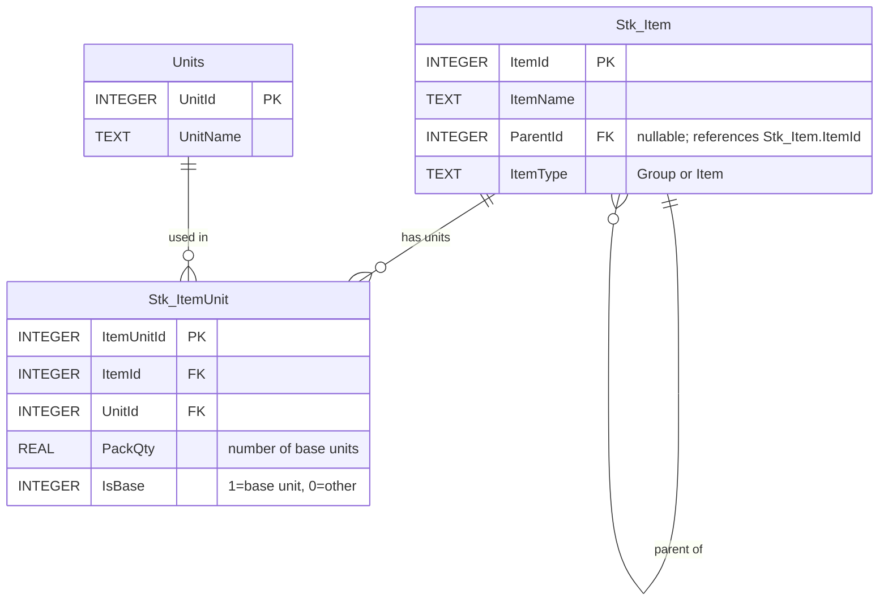

# ERD — المرحلة الأولى: الأصناف والوحدات

هذا المخطط يغطي أول طلب للمهندس صلاح فقط.

## العلاقات
- **Stk_Item → Stk_Item:** علاقة ذاتية؛ مجموعة واحدة قد تضم أصنافًا عديدة، وParentId يشير إلى ItemId.
- **Stk_Item → Stk_ItemUnit:** الصنف الواحد قد يمتلك عدة وحدات.
- **Units → Stk_ItemUnit:** اسم الوحدة العام مثل «حبة» أو «كرتون» يمكن استخدامه مع أصناف متعددة.

## مثال
| ItemId | الصنف | الوحدة | PackQty | IsBase |
|---|---|---|---|---|
| 101 | حليب | حبة | 1 | 1 |
| 101 | حليب | كرتون | 24 | 0 |
| 102 | بسكويت | حبة | 1 | 1 |
| 102 | بسكويت | كرتون | 12 | 0 |

بيع 3 كراتين حليب يعني 3 × 24 = **72 حبة**.

## ملاحظات تصميمية
- هذه أسماء أعمدة مقترحة لتجسيد وصف المهندس، وليست مخططًا نهائيًا معتمدًا.
- ينبغي فرض عدم تكرار الزوج (ItemId, UnitId)، ووحدة أساسية واحدة فقط لكل صنف، وأن PackQty أكبر من الصفر.
- يجب منع الدورات في شجرة الأصناف، ومنع استخدام سجل المجموعة كصنف في الفواتير.
- لا يُضاف جدول الحسابات أو الفواتير إلى هذه المرحلة حتى الانتهاء من شرحها.
