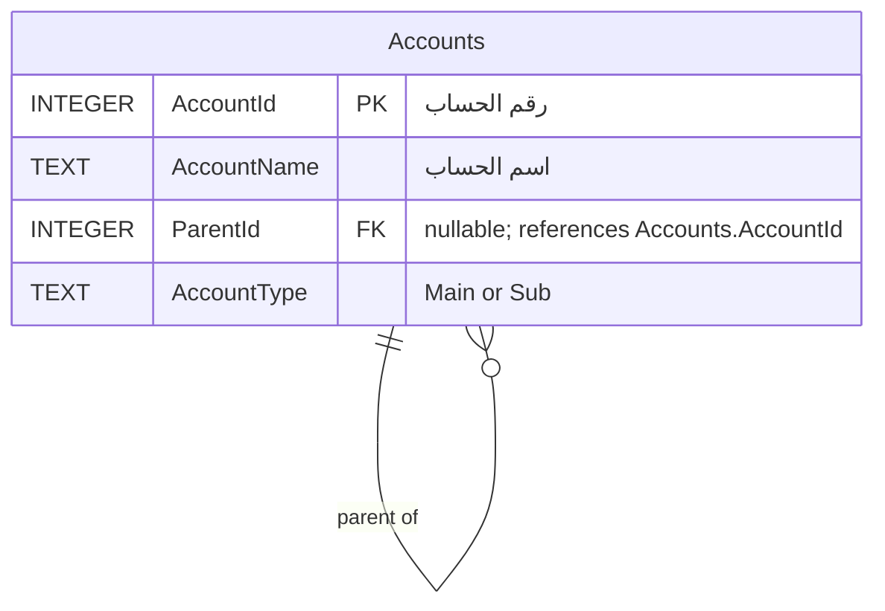

# 02 — ERD: دليل الحسابات (Accounts)

هذا المخطط يشرح الطلب الثاني: شجرة دليل الحسابات والعلاقة الذاتية بين الحساب الأب والحساب الفرعي.



## العلاقة الذاتية

- `AccountId` مفتاح أساسي فريد للحساب.
- `ParentId` مفتاح أجنبي اختياري يشير إلى `Accounts.AccountId` **داخل الجدول نفسه**.
- الحساب الأب الواحد يمكن أن يكون له عدة أبناء (1:N)، وكل حساب فرعي له أب مباشر واحد.
- الحساب يمكن أن يكون ابنًا وأبًا في الوقت نفسه.
- الحساب الجذري له `ParentId = NULL`، لا 0، ما لم ننشئ سجلًا فعليًا رقمه 0.

## مثال

| AccountId | AccountName | ParentId | AccountType |
|---|---|---|---|
| 1 | دليل الحسابات | NULL | Main |
| 11 | الصناديق | 1 | Main |
| 12 | البنوك | 1 | Main |
| 110001 | الصندوق الرئيسي | 11 | Main |
| 110002 | صندوق الفرع | 11 | Sub |
| 11000101 | صندوق المبيعات اليومية | 110001 | Sub |
| 120001 | بنك الكريمي | 12 | Sub |

> قيم `AccountType` هنا توضيحية، ويجب تحديد معناها بدقة قبل تنفيذ قاعدة البيانات: هل «رئيسي» يعني حسابًا تجميعيًا غير قابل للترحيل، و«فرعي» يعني حسابًا نهائيًا قابلًا للترحيل؟ في المثال الصندوق الرئيسي تجميعي لأنه يحتوي على ابن.

```text
دليل الحسابات (1)
├── الصناديق (11)
│   ├── الصندوق الرئيسي (110001)
│   │   └── صندوق المبيعات اليومية (11000101)
│   └── صندوق الفرع (110002)
└── البنوك (12)
    └── بنك الكريمي (120001)
```

## قواعد سلامة البيانات المقترحة

1. تفعيل `PRAGMA foreign_keys = ON` في كل اتصال SQLite.
2. منع الإشارة إلى حساب أب غير موجود.
3. منع أن يكون الحساب أبًا لنفسه، ومنع الدورات الطويلة في الشجرة بواسطة تحقق إضافي.
4. تقييد حذف الحسابات التي لها أبناء أو حركات محاسبية.
5. تحديد الحسابات التجميعية والحسابات التي يسمح بالترحيل عليها.

## مثال SQL لتعريف العلاقة

```sql
CREATE TABLE Accounts (
    AccountId INTEGER PRIMARY KEY,
    AccountName TEXT NOT NULL,
    ParentId INTEGER,
    AccountType TEXT NOT NULL CHECK (AccountType IN ('Main', 'Sub')),
    FOREIGN KEY (ParentId) REFERENCES Accounts(AccountId) ON DELETE RESTRICT,
    CHECK (ParentId IS NULL OR ParentId <> AccountId)
);
```

هذا مخطط أولي للطلب الثاني، قابل للمراجعة قبل بناء بقية النظام.
