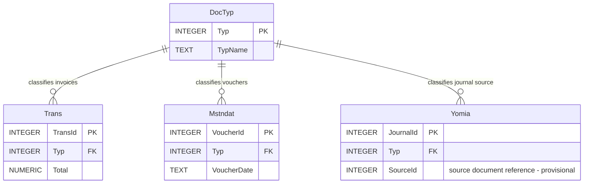

# الطلب الثالث — جدول أنواع المستندات DocTyp وعلاقاته (ERD)

> مخطط **تحليلي أولي** للعلاقات، لا يمثل الجداول النهائية بكل أعمدتها. سنراجع تفاصيل المفاتيح وربط مستندات المصدر عند تحليل الطلبات اللاحقة.

## جدول أنواع المستندات

| Typ (PK) | TypName |
|---:|---|
| 1 | فاتورة مشتريات |
| 2 | فاتورة مبيعات |
| 3 | مردود مبيعات |
| 4 | مردود مشتريات |
| 5 | سند صرف |
| 6 | سند قبض |
| 7 | قيد يومية يدوي |

## مخطط ERD — العلاقات الثلاث

### شرح العلاقات

1. **DocTyp → Trans (1:N):** نوع «فاتورة مبيعات» واحد يمكن أن تستخدمه فواتير كثيرة، وكل فاتورة لها نوع واحد.
2. **DocTyp → Mstndat (1:N):** نوع «سند قبض» واحد يمكن أن تستخدمه سندات قبض كثيرة، وكل سند له نوع واحد.
3. **DocTyp → Yomia (1:N):** نوع المستند الواحد يمكن أن يظهر في قيود يومية كثيرة، وكل سجل قيد يحمل نوع مصدر واحد في هذا التصور الأولي.

### المفاتيح

- `DocTyp.Typ` مفتاح أساسي **PK**، فريد في جدول أنواع المستندات.
- `Trans.Typ` و`Mstndat.Typ` و`Yomia.Typ` مفاتيح أجنبية **FK** تشير إلى `DocTyp.Typ`.
- تكرار قيمة `Typ` في الجداول التابعة طبيعي؛ أما داخل `DocTyp` فلا تتكرر.

### ملاحظات تصميم مهمة

- هذا الرسم يعرض **علاقة تصنيف نوع المستند** فقط، ولا يثبت بعد كيف نربط قيد اليومية بالفاتورة أو السند الأصلي.
- العمود `SourceId` في `Yomia` **ليس مفتاحًا أجنبيًا مباشرًا صالحًا لعدة جداول**. سنحدد طريقة الربط الصحيحة لاحقًا.
- في بعض الأنظمة تتكرر أرقام الفواتير بين الأنواع؛ لذلك سنراجع لاحقًا ما إذا كان مفتاح الفاتورة مستقلًا أو مركبًا من الرقم والنوع.
- يجب التحقق من أن أنواع المستندات المسموح بها داخل `Trans` تختلف عن الأنواع المسموح بها داخل `Mstndat`؛ المفتاح الأجنبي وحده لا يفرض هذا التفريق.
