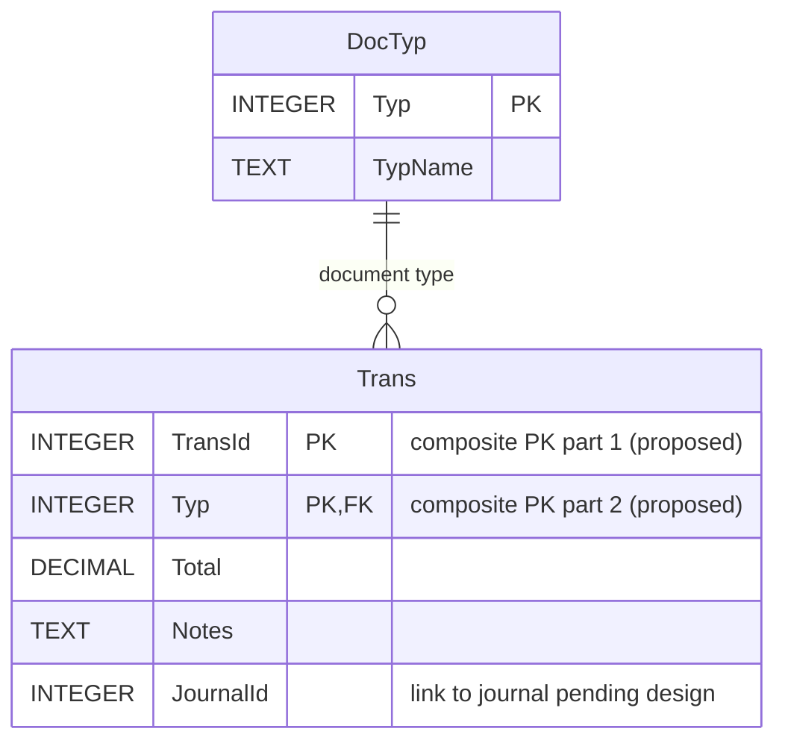

# الطلب الرابع — مخطط جدول الفواتير Trans

> مخطط ERD أولي لرأس الفاتورة، استنادًا إلى متطلبات المهندس صلاح. تفاصيل الفاتورة TransDt والقيود Yomia تُستكمل في الطلبين الخامس والسابع.

## الحقول

| العمود | المعنى | ملاحظات |
|---|---|---|
| TransId | رقم الفاتورة | جزء من مفتاح مركب مقترح |
| Typ | نوع المستند | FK إلى DocTyp.Typ وجزء من مفتاح مركب مقترح |
| Total | إجمالي الفاتورة | قيمة مالية؛ تحفظ بدقة مناسبة |
| Notes | ملاحظات | حقل نصي اختياري |
| JournalId | رقم القيد المحاسبي | مرجع مبدئي؛ تحديد FK مؤجل لحين تحليل Yomia |

## مخطط ERD

## مثال

| TransId | Typ | Total | Notes | JournalId |
|---:|---:|---:|---|---:|
| 101 | 2 | 10000 | مبيعات نقدية | 501 |
| 101 | 1 | 80000 | مشتريات | 502 |
| 102 | 2 | 15000 | مبيعات آجلة | 503 |

المفتاح المركب المقترح `(TransId, Typ)` يسمح بتكرار رقم الفاتورة عبر أنواع مختلفة، ولا يسمح بتكرار الزوج نفسه. **هذا قرار مبدئي**؛ البديل استخدام معرف داخلي فريد للفواتير مع رقم فاتورة تجاري منفصل.

## العلاقات

- `DocTyp (1) → Trans (N)`: لكل فاتورة نوع واحد، والنوع الواحد قد يرتبط بفواتير كثيرة.
- `Trans (1) → TransDt (N)`: متوقع عند دراسة تفاصيل الفاتورة في الطلب الخامس، وليس مرسومًا هنا قبل التحليل.
- `JournalId`: لا نعتمد علاقة FK إلى `Yomia` قبل تحديد ما إذا كان جدول اليومية يمثل رؤوس قيود أم أسطرها، وكيفية تمييز القيد.

## ملاحظات تنفيذية

- `Trans` يحفظ **رأس الفاتورة**، وليس أصنافها وكمياتها.
- `Total` يجب أن يتطابق مع مجموع التفاصيل بعد الخصومات/الضرائب إن وجدت، وفق القواعد التي ستُعتمد لاحقًا.
- تخزين المبالغ في SQLite يستحسن أن يستخدم أصغر وحدة نقدية صحيحة (INTEGER) أو تمثيلًا عشريًا مضبوطًا على مستوى التطبيق لتجنب أخطاء التقريب.
- وصف «نقدية/آجلة» في `Notes` ليس بديلًا عن حقل منظم لطريقة السداد.
