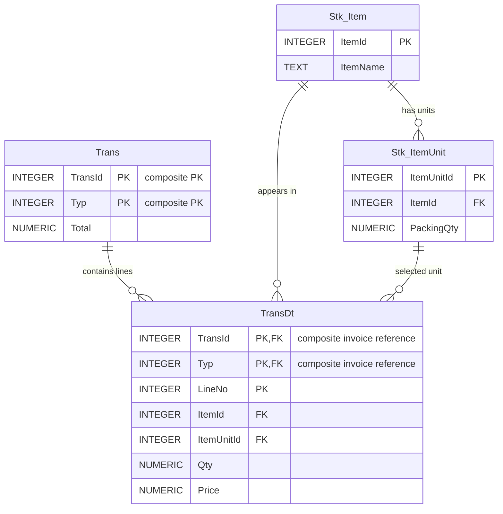

# الطلب الخامس — تفاصيل الفواتير TransDt (ERD)

هذا مخطط تحليلي أولي، متوافق مع التصميم المقترح لرأس الفاتورة في الطلب الرابع.

## الحقول

| الحقل | المعنى | الدور |
|---|---|---|
| TransId | رقم الفاتورة | جزء من PK وجزء من FK مركب إلى Trans |
| Typ | نوع الفاتورة | جزء من PK وجزء من FK مركب إلى Trans |
| LineNo | رقم السطر داخل الفاتورة | جزء من PK |
| ItemId | رقم الصنف | FK إلى Stk_Item |
| ItemUnitId | رقم وحدة الصنف | FK إلى Stk_ItemUnit |
| Qty | الكمية بالوحدة المختارة | عدد موجب |
| Price | سعر الوحدة المختارة | قيمة مالية غير سالبة |

المفتاح الأساسي المقترح: `PRIMARY KEY (TransId, Typ, LineNo)`.

## مخطط العلاقات

## مثال عملي

فاتورة مشتريات `TransId=100` و`Typ=1`:

| TransId | Typ | LineNo | ItemId | ItemUnitId | Qty | Price | LineTotal |
|---:|---:|---:|---:|---:|---:|---:|---:|
| 100 | 1 | 1 | 10 | 102 | 3 | 6000 | 18000 |
| 100 | 1 | 2 | 10 | 101 | 5 | 300 | 1500 |

في هذا المثال الحليب `ItemId=10` يظهر مرتين: بالكرتون `ItemUnitId=102` (24 حبة) وبالحبة `ItemUnitId=101` (1 حبة). إجمالي الفاتورة 19500، والكمية الأساسية 77 حبة.

## قواعد العلاقات وسلامة البيانات

- `Trans (1) → TransDt (N)`: كل سطر ينتمي إلى فاتورة واحدة، وقد تضم الفاتورة عدة أسطر.
- `Stk_Item (1) → TransDt (N)`: الصنف قد يظهر في أسطر كثيرة.
- `Stk_ItemUnit (1) → TransDt (N)`: وحدة صنف محددة قد تستخدم في أسطر كثيرة.
- `(TransId, Typ)` في التفاصيل مفتاح أجنبي **مركب** إلى `Trans(TransId, Typ)` وفق التصميم المقترح.
- يجب التأكد من تطابق `ItemId` مع الصنف المرتبط بـ`ItemUnitId`، مثل فرض `UNIQUE(ItemUnitId, ItemId)` على `Stk_ItemUnit` ثم `FOREIGN KEY(ItemUnitId, ItemId) REFERENCES Stk_ItemUnit(ItemUnitId, ItemId)` في `TransDt`؛ ويمكن عندها الاستغناء عن FK المنفصل لـ`ItemUnitId` لأنه مشمول في المركب.
- `LineNo` يميز السطر **داخل الفاتورة** وليس على مستوى كل الفواتير، ويولده التطبيق عند إضافة السطر.
- `Qty` هي كمية الوحدة المختارة؛ الكمية الأساسية = `Qty × PackingQty`.
- `Price` سعر الوحدة المختارة؛ إجمالي السطر المبدئي = `Qty × Price` قبل أي خصومات أو ضرائب.
- في SQLite يجب تفعيل `PRAGMA foreign_keys=ON` لكل اتصال، ومراعاة دقة تمثيل المبالغ المالية.

## نقاط مفتوحة

- تثبيت سياسة ترقيم الفواتير: المفتاح المركب `(TransId,Typ)` أم معرف داخلي فريد.
- تحديد تفاصيل الخصم والضريبة والتكلفة وآلية تقريب المبالغ.
- تثبيت المفاتيح والقيود النهائية في مرحلة SQL.
