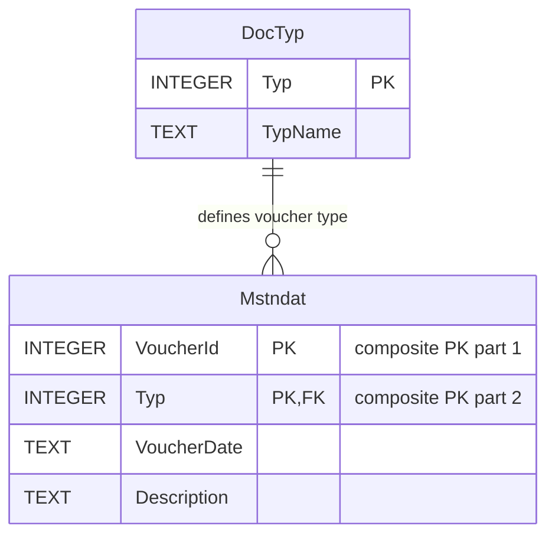

# الطلب السادس — مخطط جدول السندات Mstndat

مخطط ERD أولي لجدول سندات القبض والصرف، وفق متطلبات المهندس صلاح.

## الحقول المقترحة

| العمود | المعنى | الدور |
|---|---|---|
| VoucherId | رقم السند | جزء من مفتاح أساسي مركب مقترح |
| Typ | نوع السند | جزء من المفتاح المركب ومفتاح أجنبي إلى DocTyp |
| VoucherDate | تاريخ السند | تاريخ العملية |
| Description | البيان | سبب العملية |

## مخطط ERD

## مثال

| VoucherId | Typ | VoucherDate | Description |
|---:|---:|---|---|
| 101 | 6 | 2026-11-03 | قبض من العميل أحمد |
| 101 | 5 | 2026-11-03 | دفع فاتورة الكهرباء |
| 102 | 6 | 2026-11-03 | قبض من العميل محمد |

- `Typ=5`: سند صرف.
- `Typ=6`: سند قبض.
- يُحفظ النوعان في **جدول واحد**، مع إمكان عرض شاشتين منفصلتين.
- العلاقة `DocTyp (1) → Mstndat (N)`.
- المفتاح الأساسي المقترح `PRIMARY KEY (VoucherId, Typ)` يتيح تكرار رقم السند عبر الأنواع المختلفة، لا داخل النوع الواحد.
- المفتاح الأجنبي `Mstndat.Typ → DocTyp.Typ`.
- يجب أن يقصر التطبيق/قاعدة البيانات أنواع السندات على الأنواع المسموح بها؛ وجود FK وحده لا يضمن أن النوع قبض أو صرف فقط.

## مسائل ستُحسم لاحقًا

1. **المبالغ**: الحقول المذكورة لا تتضمن مبلغ السند. نراجع تمثيله عبر القيود المحاسبية `Yomia`، وما إذا كان مطلوبًا حقل مبلغ إضافي.
2. **ربط اليومية**: تحديد العلاقة بين `Mstndat` و`Yomia` عند تحليل الطلب السابع. قد يلزم ربط مركب `(VoucherId, Typ)` أو جدول وسيط/رأس قيد.
3. **الترقيم**: اعتماد المفتاح المركب نهائيًا أو استخدام معرف داخلي فريد.
4. **التاريخ**: صيغة `YYYY-MM-DD` في SQLite، مع قواعد تحقق مناسبة.
