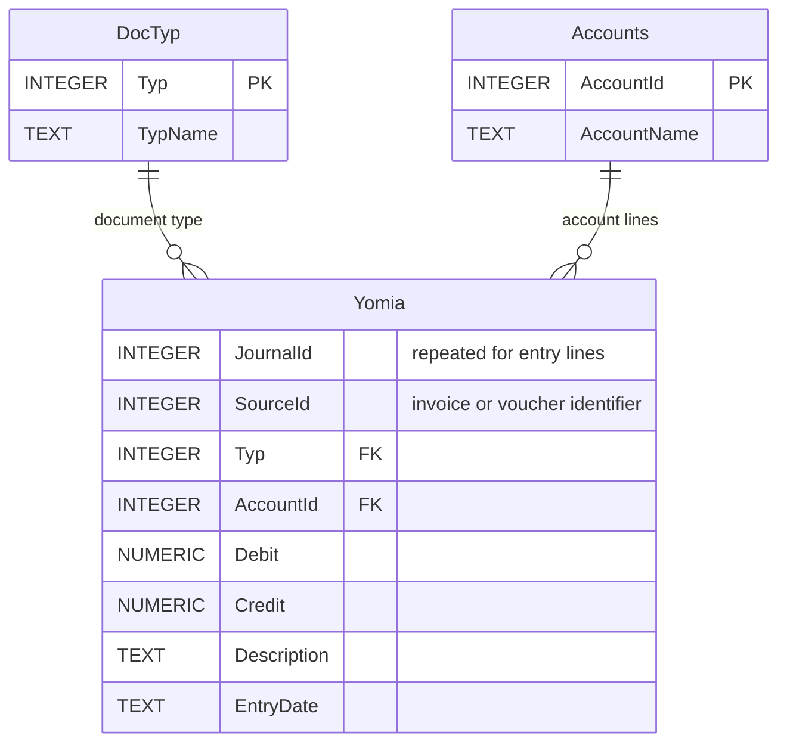

# الطلب السابع — تحليل أولي لجدول اليومية المحاسبية Yomia

> **الحالة:** مسودة تعليمية أولية مرفوعة بناءً على طلب المستخدم. لم يُعتمد المخطط النهائي أو مفاتيحه بعد.

## الهدف

تسجيل أثر كل عملية مالية على الحسابات وفق مبدأ القيد المزدوج: مجموع المدين يساوي مجموع الدائن لكل قيد مرحّل.

## الحقول الواردة في المتطلبات

- رقم القيد المحاسبي `JournalId`.
- رقم الفاتورة أو السند المصدر `SourceId`.
- نوع الفاتورة أو السند `Typ`، ويرتبط بجدول `DocTyp`.
- رقم الحساب `AccountId`، ويرتبط بجدول `Accounts`.
- المبلغ المدين `Debit`.
- المبلغ الدائن `Credit`.
- البيان `Description`.
- تاريخ القيد `EntryDate`.

**مهم:** `JournalId` يتكرر في عدة أسطر من القيد الواحد؛ لذا لا يصح اعتباره وحده مفتاحًا أساسيًا لأسطر اليومية. يلزم رقم سطر أو معرف مستقل، ويُحسم ذلك في التحليل التالي.

## مثال: شراء بضاعة نقدًا بقيمة 50,000

فاتورة مشتريات رقم 25، نوعها 1، ورقم القيد 1001:

| JournalId | SourceId | Typ | AccountId | Debit | Credit |
|---:|---:|---:|---:|---:|---:|
| 1001 | 25 | 1 | 120 (مخزون) | 50000 | 0 |
| 1001 | 25 | 1 | 110 (صندوق) | 0 | 50000 |

مجموع المدين 50,000 = مجموع الدائن 50,000.

## ERD مبدئي للعلاقات المفاهيمية

**تنبيه:** العلاقة بين `Yomia.SourceId` وكل من `Trans` و`Mstndat` **ليست FK عاديًا صالحًا** ما دام المصدر يتغير بحسب `Typ`. يجب تصميم تحقق وربط آمنين لاحقًا. هذا الرسم لا يدعي اكتمال تلك العلاقة.

## قرارات لم تُحسم بعد

1. إضافة `LineNo` مع مفتاح مركب `(JournalId, LineNo)`، أو فصل رأس القيد عن تفاصيله.
2. آلية الربط بالمستند المصدر، خصوصًا أن مفاتيح `Trans` و`Mstndat` مقترحة كمفاتيح مركبة مع `Typ`.
3. قواعد منع ترحيل القيود غير المتوازنة، وعدم السماح بقيم مدين/دائن غير صحيحة.
4. هل قيود السندات اليدوية `Typ=7` تحتاج سجل رأس مستقلًا؟
5. تحديد طريقة تخزين المبالغ بدقة مناسبة في SQLite.

سيُحدَّث الملف بعد إكمال شرح الطلب السابع واعتماد التصميم النهائي.
