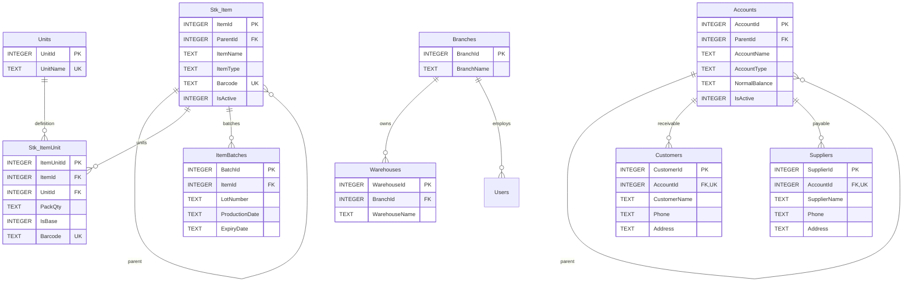

# 08 — المخطط التفصيلي: البيانات الأساسية والأصناف
هذا امتداد للمخططات 01 و02 و03، دون استبدالها. PK أساسي، FK أجنبي، UK فريد.

## قواعد ملزمة
- (ItemId,UnitId) فريد، ووحدة أساسية واحدة لكل صنف؛ PackQty عدد عشري موجب مخزن بدقة، لا REAL للأموال.
- لا يُسمح ببيع صنف من نوع Group، ولا إنشاء دورة أب/ابن في شجرة الحسابات أو الأصناف.
- (ItemId,LotNumber) فريد عند وجود رقم دفعة؛ صلاحية الدفعة اختيارية حسب الصنف.
- حساب العميل/المورد حساب ترحيل فرعي؛ الحساب الرئيسي لا يُرحّل عليه.
- حقول ParentId تقبل NULL للجذر، ويجب منع حذف سجل مرجعي مستخدم.
- هذه أسماء الحقول المقترحة للمخطط النهائي، وقد تختلف عن النسخة التنفيذية القديمة.
