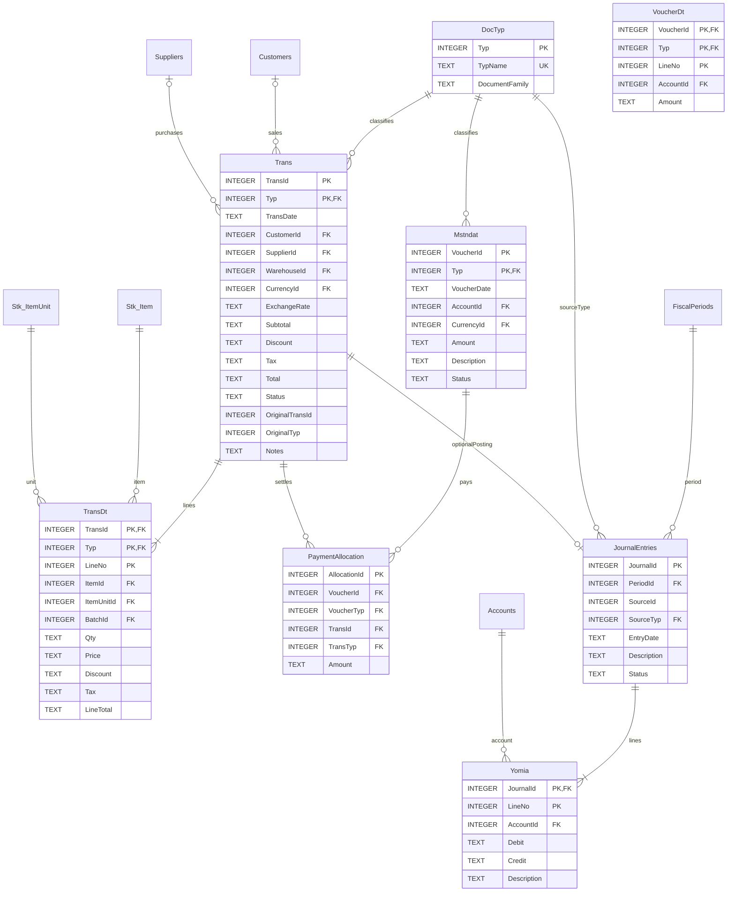

# 09 — المخطط التفصيلي: الفواتير والسندات والقيود
يحافظ على أسماء المهندس صلاح: DocTyp, Trans, TransDt, Mstndat, Yomia. يضاف رأس القيد JournalEntries والتخصيص PaymentAllocation.

## مفاتيح مركبة وقواعد
- PK(TransId,Typ) في Trans، وPK(TransId,Typ,LineNo) في TransDt؛ FK(TransId,Typ) مرجعه Trans.
- PK(VoucherId,Typ) في Mstndat؛ FK(VoucherId,Typ) في VoucherDt وPaymentAllocation.
- FK(ItemUnitId,ItemId) إلى مفتاح فريد مطابق في Stk_ItemUnit؛ لضمان الوحدة تخص الصنف.
- القيد PK(JournalId,LineNo)؛ JournalId وحده يتكرر على الأسطر. لا يلزم FK مباشر من Trans إلى JournalEntries إذا اعتمدنا الربط الموحد بمصدر القيد.
- SourceId+SourceTyp علاقة متعددة الأهداف؛ لا يمكن فرض FK عادي واحد على Trans وMstndat معًا. يُفرض بالترحيل والتحقق، أو جدول مصدر موحد DocumentRegistry.
- ينبغي تثبيت أنواع DocTyp الحالية قبل التنفيذ وعدم تغيير دلالتها؛ السند 5 صرف و6 قبض بحسب المخطط السابق.
- لا يتجاوز تخصيص الدفعات مبلغ السند أو رصيد الفاتورة؛ ويمنع الجمع بين CustomerId وSupplierId في نفس الفاتورة إلا بتصميم موثق.
- تحقق توازن القيد، ومنع التعديل بعد الترحيل، وعكس القيد عند التصحيح، وترحيل المستند والقيد والمخزون داخل transaction واحدة.
- جميع المبالغ والكميات المعروضة TEXT هنا لتمثيل عشري مضبوط في طبقة التطبيق؛ يلزم تعريف تحقق عددي دقيق عند تنفيذ SQLite، أو اختيار INTEGER بوحدة قياس صغرى ثابتة.
