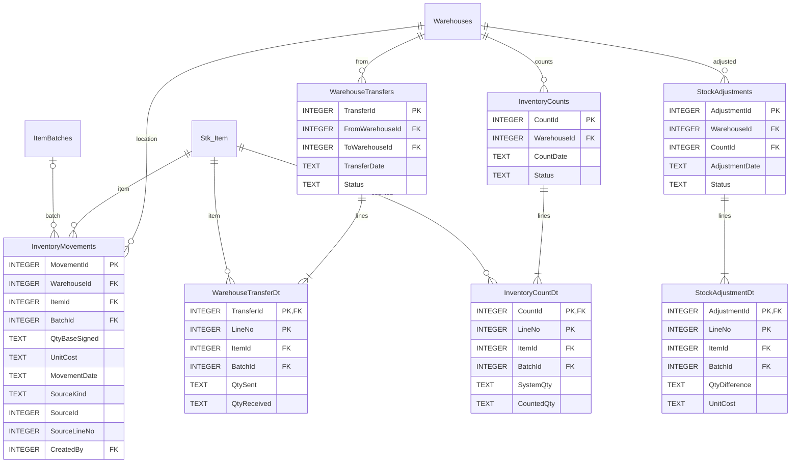

# 10 — المخطط التفصيلي: المخزون والجرد والتحويل

## قواعد
- الكميات تحفظ بالوحدة الأساسية بعد ضرب PackQty، وتستخرج الأرصدة من مجموع الحركات المعتمدة لكل مستودع وصنف ودفعة.
- لا يسمح بالتحويل إلى المستودع نفسه؛ نقل 50 واستلام 45 ينتج فرق 5 قيد المراجعة، لا تسوية صامتة.
- الجرد مسودة ثم اعتماد؛ تسوية الفروقات تنشئ حركة مخزون وقيدًا محاسبيًا متوازنين.
- لا تُحذف حركات مرحّلة؛ الإلغاء بحركات عكسية. منع تكرار ترحيل نفس مصدر الحركة.
- SourceKind/SourceId رابط متعدد الأنواع ويحتاج تحققًا تطبيقيًا أو سجل مستندات موحدًا.
