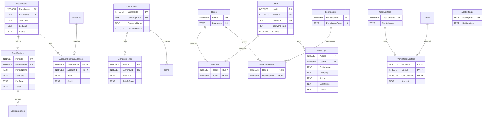

# 11 — المخطط التفصيلي: المالية والمستخدمون والصلاحيات

## قواعد
- لا تداخل بين الفترات المالية داخل السنة؛ يمنع ترحيل المستند في فترة مغلقة.
- القيود الافتتاحية على الحسابات الفرعية فقط؛ منع إدخال مدين ودائن موجبين معًا في نفس سطر.
- سعر الصرف يجب أن يكون موجبًا، ويثبت سعر المستند وقت الترحيل.
- كلمات المرور تخزن hash آمنًا لا نصًا واضحًا؛ التحقق من الصلاحيات في طبقة الأعمال وليس الواجهة فقط.
- YomiaCostCenters جدول اختياري لتوزيع السطر على أكثر من مركز تكلفة.
- سجلات التدقيق تحفظ التغييرات المهمة دون تخزين كلمات مرور أو أسرار.
